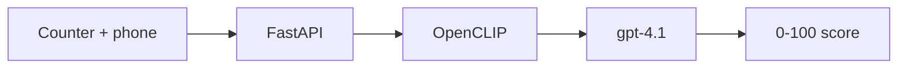

<!-- # Created by Caleb M. Irvine for use by Moto Reloaded -->

# Gear Intake Checker

The counter shows a QR code. The phone shoots six angles of a jacket or pants. The app returns a 0–100 **photo coverage + damage disclosure** score and a route. It does not certify safety.

Diagram: [`docs/gear-intake-architecture.drawio`](docs/gear-intake-architecture.drawio)

OpenCLIP matches the angle locally and stays frozen. `score_photos()` asks Azure gpt-4.1 for a checklist. `compute_score()` turns that checklist into the number. No model is trained on the photos.

| Score | Route |
|---|---|
| 85–100 | Logged. Staff still confirm the garment in hand. |
| 50–84 | In-hand review. |
| 0–49 | Declined for buy-in, or a retake if a photo is still missing. |

A crash, contamination, Zone 1 damage or repair, or a broken or missing required protector is declined and sent toward upcycling. A missing CE label is not a failure. One damage close-up is asked for only when a spot looks wrong.
